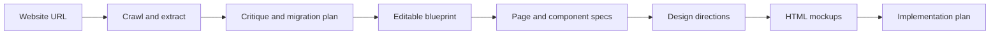

# Web Architect AI

Turn an existing website into a reviewable migration blueprint, page and component specifications, and AI-generated design directions.

**Status: experimental local prototype.** This is a workbench for exploring and reviewing a migration, with drafts and HTML mockups as outputs.

## What it does

- Crawls a website with Puppeteer and extracts page structure, content, media, forms and technology signals.
- Groups similar pages and lets you inspect and edit the resulting blueprint and content mapping.
- Runs AI-assisted critique and migration planning, then generates page and component specifications.
- Offers design directions and generates five HTML mockup variants through a multi-stage workflow.
- Persists sessions and assets locally under `data/sessions`.



## Run locally

Use Node.js and npm compatible with the project's Next.js 16 dependency.

```bash
git clone https://github.com/JonasR-Git/web-architect-ai.git
cd web-architect-ai
npm ci
```

Create `.env.local` in the repository root. For real model calls:

```dotenv
OPENROUTER_API_KEY=your_openrouter_api_key
```

The default model is defined in `src/lib/openai.ts`. If it is unavailable to your OpenRouter account, set `AI_MODEL_ID` to an available model before starting real AI calls.

Alternatively, enable mock AI responses without a provider key:

```dotenv
USE_MOCK=true
```

Then start the application:

```bash
npm run dev
```

Open [localhost:3000](http://localhost:3000), enter a website URL and work through the analysis, blueprint and design flow. Use a site you own or are authorised to crawl. Mock AI mode concerns model responses; it should not be treated as a guarantee that crawling makes no network requests.

## Architecture

| Layer | Implementation |
| --- | --- |
| Application | Next.js App Router, React and TypeScript |
| Server workflows | Server Actions and an SSE crawl API |
| Website intake | Puppeteer crawler and extraction logic |
| AI orchestration | OpenRouter SDK with configurable models for analysis and generation stages |
| Workbench | Analysis, blueprint editing, specifications and design/mockup workflows |
| Persistence | Local filesystem sessions and assets |

Entry points include `src/app/actions.ts`, `src/modules/core/ai-service.ts`, `src/modules/core/persistence.ts` and `src/modules/core/views/home-view.tsx`.

## Configuration

`OPENROUTER_API_KEY` enables provider-backed AI calls. The implementation also recognises `USE_MOCK` and `CRAWLER_MODE`, plus model overrides for individual workflow stages.

<details>
<summary>Model override variable names</summary>

- `AI_MODEL_ID`
- `LIGHTWEIGHT_MODEL`
- `AI_MODEL_CRITIQUE`
- `AI_MODEL_MIGRATION`
- `AI_MODEL_COMPONENT`
- `AI_MODEL_CONTENT`
- `AI_MODEL_SPECIFICATION`
- `AI_MODEL_DESIGN`
- `AI_MODEL_IMPLEMENTATION`
- `AI_MODEL_MOCKUP`
- `AI_MODEL_STYLE`
- `MOCKUP_STAGE1_MODEL` through `MOCKUP_STAGE5_MODEL`
- `MOCKUP_STAGE3_TEMPERATURE`

Refer to the implementation for defaults and supported values. The model choice can affect quality, latency and cost.

</details>

## Quality checks

The repository declares these checks:

```bash
npm run lint
npm run build
```

To run a built application locally:

```bash
npm start
```

There is currently no configured `npm test` command. An existing test-like source file does not constitute a runnable test suite. The commands above document the available checks; they are not a claim that a particular revision passed them.

## Current boundaries

- Sessions are stored locally; hosted persistence and a multi-user authentication model are not established features.
- Missing provider configuration can produce mock or fallback data. Check the active mode before interpreting output as a real analysis.
- Crawling can be resource-intensive, and limits differ between execution paths.
- AI-generated plans, specifications and mockups need review before being used for an actual migration.
- The repository does not yet include an automated CI workflow, a provider configuration example file or a published licence.

## Suggested next steps

These are proposed improvements, rather than shipped capabilities:

- Configure a test runner and CI checks.
- Add `.env.example` and clearer mode indicators.
- Publish a short demo with a reproducible example website.
- Add consistent crawl limits and evaluation cases for blueprint and specification quality.
- Define hosted storage and access control before deploying for multiple users.
