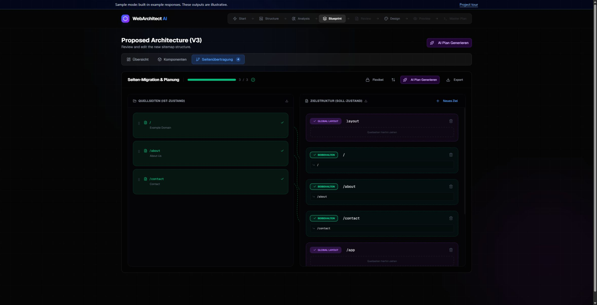
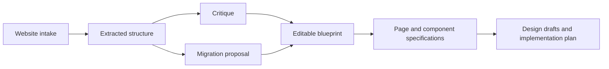

# Web Architect AI

[](https://github.com/JonasR-Git/web-architect-ai/actions/workflows/ci.yml)

**Make website migration reviewable.** Explore the existing structure, inspect a proposed blueprint, then turn approved decisions into page specifications and design drafts.

[Interactive project guide](https://jonasr-git.github.io/web-architect-ai/) · [Reproducible workflow](docs/WORKFLOW_EXAMPLE.md) · [Architecture](docs/ARCHITECTURE.md)

Built by Jonas Fendel with TypeScript, Next.js, Puppeteer and configurable LLM workflows. **Experimental local prototype:** generated outputs are drafts for human review, not completed production migrations.

## Why I built it

A website migration involves decisions about existing content, URLs, reusable patterns and the target experience. A prompt that produces a new homepage leaves most of those decisions invisible.

This workbench makes them inspectable. Website extraction feeds an editable blueprint; page and component specifications depend on the reviewed structure; design and implementation artifacts remain linked to that context.

## Explore it in two minutes

The [public guide](https://jonasr-git.github.io/web-architect-ai/) needs no installation or API key. Inspect a fictional three-page site, change its About-page target path and download the updated JSON draft.

The guide's content is hand-authored sample data. It makes no model calls or crawl requests. The full local application has a separate built-in sample mode and a provider-backed mode, visibly identified in the workbench.



Actual application screenshot from the sample intake-to-blueprint walkthrough. The public guide uses a separate, smaller fictional example.

## What the workbench does

- Extracts page structure, content, media, forms and technology signals with Puppeteer.
- Groups similar pages and lets the user review content and URL mappings.
- Runs critique and migration planning in parallel, then generates dependent page/component specifications.
- Explores design directions and produces HTML mockup variants and implementation plans.
- Persists sessions and assets in the local workspace under `data/sessions`.



## Run locally

Use **Node.js 22.12 or newer** and npm.

```bash
git clone https://github.com/JonasR-Git/web-architect-ai.git
cd web-architect-ai
npm ci
cp .env.example .env.local
npm run dev -- --hostname 127.0.0.1
```

Open [localhost:3000](http://localhost:3000). The example configuration enables `USE_MOCK=true`; a provider key is not needed. Follow the [sample walkthrough](docs/WORKFLOW_EXAMPLE.md), or open `/demo/index.html` for the interactive project guide served locally.

For provider-backed output, set `USE_MOCK=false`, supply your own `OPENROUTER_API_KEY` and set `AI_MODEL_ID` to a model available to your account. Treat model choice as an explicit configuration decision; provider availability and pricing can change.

Only crawl websites you own or are authorised to inspect. Keep the full application bound to localhost: authentication and a hosted multi-user storage model are not established features.

## Architecture

| Layer | Implementation |
| --- | --- |
| Workbench | Next.js App Router, React and TypeScript |
| Intake | Puppeteer crawler, extraction and SSE progress |
| Orchestration | Server Actions and configurable OpenRouter models per stage |
| Review | Structure, mapping, content, specification and design views |
| Persistence | Local filesystem sessions and assets |
| Public project guide | Static HTML/CSS/JavaScript, no application backend or model key |

The [architecture note](docs/ARCHITECTURE.md) explains stage dependencies, execution modes, storage and current trade-offs. Useful entry points are `src/app/actions.ts`, `src/modules/core/ai-service.ts`, `src/modules/core/persistence.ts` and `src/modules/analysis/workflows`.

## Quality checks

```bash
npm run typecheck
npm test
npm run lint:focused
npm run build
```

CI runs a clean install, TypeScript checking, focused regression tests, lint on the maintained core and a sample-mode production build. Tests cover clustering and mapping behavior. The public guide's controls and the sample intake-to-blueprint flow were manually verified in a browser; those interactions are not automated in CI.

`npm run lint:all` exposes the wider legacy lint backlog. Focused lint passing is not a claim that the entire existing codebase is lint-clean. Tests and the sample flow are not a benchmark of model quality or a validation of every real-world crawl.

On 12 October 2026, dependency updates removed the original audit's critical and high-severity runtime findings. Five moderate transitive runtime findings remain in the image-colour dependency chain; development tooling has five high-severity findings. Check `npm audit` for the current advisory state before extending or hosting the prototype.

## Configuration

`.env.example` starts with safe sample settings. Server-side environment variables include:

| Variable | Purpose |
| --- | --- |
| `USE_MOCK` | Built-in sample responses when set to `true` |
| `OPENROUTER_API_KEY` | Your provider credential; never commit it |
| `AI_MODEL_ID` | Default model selected for your provider account |
| `AI_MODEL_CRITIQUE`, `AI_MODEL_MIGRATION` | Analysis-stage overrides |
| `AI_MODEL_COMPONENT`, `AI_MODEL_SPECIFICATION` | Specification-stage overrides |
| `AI_MODEL_DESIGN`, `AI_MODEL_IMPLEMENTATION` | Output-stage overrides |

Further task and mockup-stage overrides are defined in `src/lib/openai.ts` and `src/app/actions.ts`. Local sessions and `.env.local` are ignored by Git.

## Current boundaries

- Local sessions are inspectable and exportable, but hosted persistence and multi-user access control are not implemented.
- The analysis workflow stops on failed or fallback critique, migration or component results. Sample mode is visibly labelled; generated artifacts still require review.
- Real crawling can be resource-intensive; execution paths still need consistent crawl limits and broader integration coverage.
- No controlled evaluation establishes AI quality, migration success rate or performance savings.
- This repository is public source, with no repository-wide reuse license currently granted. Dependency and upstream component licenses remain applicable.

## Next engineering milestones

Add bounded crawler integration tests, consistent resource limits, a small evaluation dataset for mapping/specification quality, and a hosted storage/access-control design before considering multi-user deployment.
