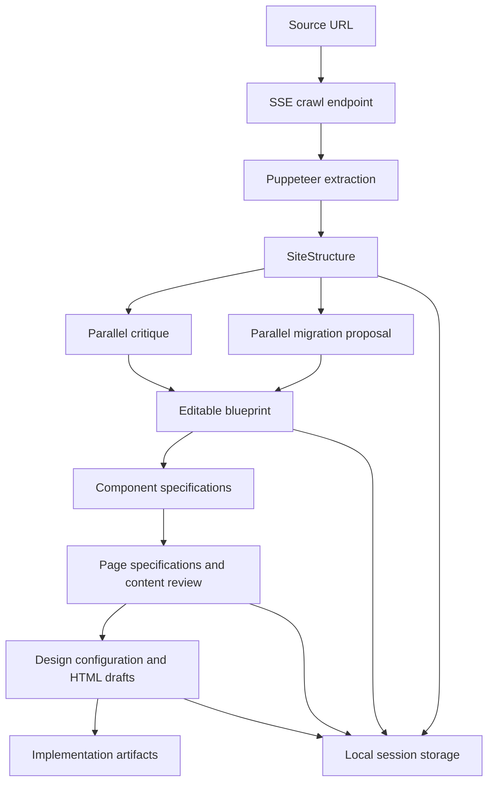

# Architecture

Web Architect AI separates website intake, AI-assisted proposals and human review. It is a local prototype with a static public project guide.

## The data flow

## Boundaries and decisions

**Extraction precedes generation.** The crawler produces structured input instead of asking a model to invent the source site's contents. Similarity/grouping utilities help reduce repetitive pages into reviewable patterns.

**Independent analysis can run in parallel.** Critique and migration proposals share the same input, while component extraction and page specifications depend on earlier results. `use-ai-analysis-workflow.ts` makes those dependencies explicit.

**Review stays in the workflow.** Proposed URLs, content roles and design drafts are editable. There is no autonomous production migration or deployment stage in this application.

**Models can vary by task.** `src/lib/openai.ts` holds model overrides; `src/modules/core/ai-service.ts` connects the stages to OpenRouter. This is workflow orchestration, not evidence of a measured advantage from any model combination.

**Local storage keeps the prototype inspectable.** `src/modules/core/persistence.ts` stores sessions and assets under the workspace. This design is suitable for a local workbench; a multi-user service would need explicit authentication, authorization, tenant isolation and durable storage.

## Execution modes

- With `USE_MOCK=true`, or no provider key, supported application actions use built-in samples. The SSE intake path returns a predefined three-page structure. The runtime banner calls `/api/runtime-mode`, which reveals only the execution mode, never a credential.
- With a provider key and `USE_MOCK=false`, real extraction and provider-backed responses are enabled on the appropriate paths. The analysis workflow rejects failed or fallback responses for critique, migration and component extraction; the blueprint is committed only after all three stages succeed. Other generated artifacts still require review.
- The public project guide is a separate static demonstration with its own hand-authored fictional data. It requires no server actions, crawler or provider configuration.

## Quality coverage

CI checks TypeScript, maintained-core lint, focused regression tests and a production build. The tests cover clustering and mapping boundaries. Manual browser QA covered the sample intake-to-blueprint path and the guide's editing/export behavior; browser interaction tests are not automated in CI.

Real-provider calls, full-site crawling, multilingual content fidelity and model-output quality require broader integration and evaluation work. A successful build does not establish those outcomes.
